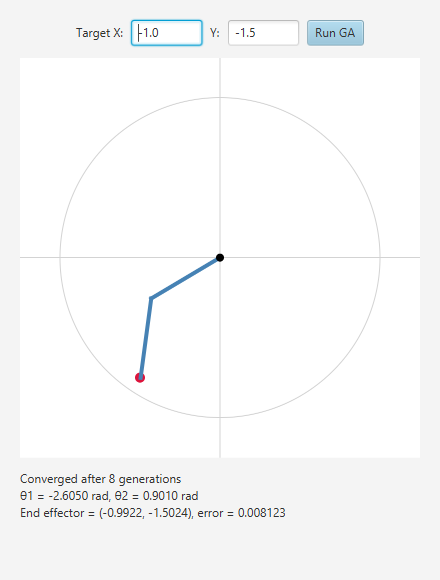
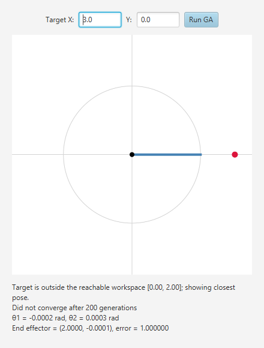

# Genetic Algorithm Inverse Kinematics for a 2D Robot Arm (JavaFX)



## 📌 Overview

This project solves **inverse kinematics** for a **2-link planar robot arm** with a **genetic algorithm (GA)**.
Given a target point (x, y), the GA searches for the two joint angles (θ1, θ2) that place the end effector on it, and a **JavaFX** window draws the resulting pose.

It was written as coursework for **CSC4702 Pembangunan Sistem Robotik (Robotic System Development)**, UPM.

---

## 🎯 Objectives

* Apply a population-based search to a robotics problem instead of closed-form geometry
* Use **forward kinematics** as the fitness function
* Handle edge cases such as targets the arm cannot reach
* Keep runs reproducible and the algorithm covered by unit tests

---

## 🧠 How the Genetic Algorithm Works

| Step | What it does |
|---|---|
| **Individual** | A pair of joint angles (θ1, θ2) |
| **Fitness** | Distance between the end effector (from forward kinematics) and the target; lower is better |
| **Selection** | Tournament selection |
| **Crossover** | BLX-α (α = 0.5), which can also explore slightly beyond the parents' range |
| **Mutation** | Gaussian noise with a configurable standard deviation |
| **Elitism** | The best individual always survives into the next generation |
| **Angle limits** | Angles wrap around when the range is a full turn, otherwise they are clamped |
| **Stopping** | Error below the tolerance (default 0.01), the generation limit, or no improvement for 50 generations |

Default settings: population 80, mutation rate 0.3, crossover rate 0.8, up to 200 generations, angles in [-π, π].
All of them are held in `GAParameters`, including an optional **random seed** for reproducible runs.

### Kinematic model

* x = L1 cos(θ1) + L2 cos(θ1 + θ2)
* y = L1 sin(θ1) + L2 sin(θ1 + θ2)

Both links are 1.0 long by default, so the arm reaches any point with a distance from the base of 0 to 2.

---

## 🖥️ Features

* Type a target (X, Y) and press **Run GA**
* Canvas shows the base, both links, the workspace circle and the target
* Result panel reports whether it converged, the generation count, θ1, θ2, the end-effector position and the error
* **Unreachable targets** are detected: the app warns, shows the closest pose it can make, and zooms out so the target stays visible



* Invalid input gives a message instead of an error
* A console runner is included for quick experiments

---

## 🧰 Technology Stack

* Java 17 or later (built and tested on JDK 23)
* JavaFX 17
* Maven
* FXML for the UI layout, canvas-based rendering
* JUnit 5 for tests

---

## 📂 Project Structure

* `IKApplication`: JavaFX entry point
* `IKController`: UI logic and drawing; also holds the default GA settings
* `GeneticAlgorithm`: the GA engine, returning a `Result` and reporting each generation to an optional listener
* `GAParameters`: validated, immutable GA settings
* `Individual`: one candidate solution and its fitness
* `RobotArm2D`: forward kinematics and the reachability check
* `IKConsole`: command-line runner
* `ik-view.fxml`: UI layout
* `src/test`: unit tests for the arm, individual and GA (convergence, reproducibility, angle bounds, early stop, parameter validation)

---

## 🚀 How to Run

Requires **JDK 17 or later**. Maven downloads JavaFX for you.

```bash
./mvnw javafx:run     # Windows: mvnw.cmd javafx:run
./mvnw test           # run the unit tests
```

Console version, with an optional target:

```bash
./mvnw compile exec:java -Dexec.mainClass=com.csc4702.ikga2d.IKConsole -Dexec.args="1.2 0.8"
```

If Maven reports that no compiler is available, `JAVA_HOME` points at a JRE (or an old Java). Point it at a JDK 17+.
You can also open the project in IntelliJ IDEA and run `IKApplication`.

---

## 📈 Possible Future Enhancements

* Animate the arm over the generations
* Joint limits and obstacle avoidance
* Compare against an analytical solution
* More than two links

---

## 📄 Licence

[MIT](LICENSE)
